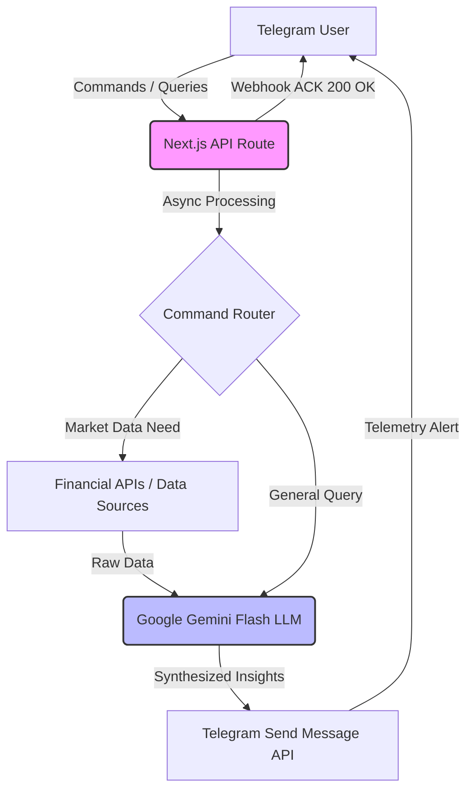

# Telegram Gemini Bot

> **Real-time market data sentiment and financial telemetry bot delivered straight to your phone.**

A Next.js 14 (App Router) Telegram bot using the Gemini API (gemini-3.8-flash with gemini-3-flash-preview fallback model) for real-time financial data synthesis and market sentiment delivery. Uses webhooks and interim Telegram messages for Vercel serverless.

**Project films:** two independently composed 20-second cuts, with music and soft action chimes.

[Watch or download the landscape film](media/telegram-gemini-bot-demo-16x9.mp4)

Landscape (16:9). [Download the film](media/telegram-gemini-bot-demo-16x9.mp4).

<b>On a phone?</b> Watch the vertical cut (20 seconds)

[Watch or download the vertical film](media/telegram-gemini-bot-demo-9x16.mp4)

Independently composed for 9:16. [Download the film](media/telegram-gemini-bot-demo-9x16.mp4).

Genuine bot output in a staged phone interface. Music: Deep Techno Ambience by Alejandro Magana (Mixkit). [Film provenance](media/README.md).

**Author:** [Tejas Hendre](https://www.tejashendre.com/)

---

## 1. The Business Problem (Why I built this)

Professional intelligence workflows depend on speed and accessibility. Checking dashboards requires context-switching; receiving automated, synthesized intelligence directly in a secure messaging client reduces friction. 

This bot was built to act as a financial telemetry engine, consuming real-time market data and using Google's Gemini Flash model to synthesize it into immediately actionable insights delivered on-the-go via Telegram.

---

## 2. System Architecture & Flow

The webhook sends an interim Telegram message while processing the query. It awaits the result and Telegram delivery before returning HTTP 200. Bounded provider requests keep the operation within Vercel's function duration.

---

## 3. Core Principles & Execution (How I do my work)

- **Serverless Resilience:** Designed specifically for Vercel's App Router environment. The webhook awaits processing, with bounded market-data requests and Gemini fallback attempts.
- **Speed over Bloat:** Uses `gemini-3.8-flash with gemini-3-flash-preview fallback` because intelligence delivery on mobile messaging needs to be near-instantaneous.
- **Secure by Default:** Utilizes a custom `CRON_SECRET` to secure scheduled tasks and locks telemetry down to specific authorized `TELEGRAM_CHAT_ID`s.

---

## 4. Tech Stack

- **Framework:** Next.js 14 (App Router), TypeScript
- **APIs:** Telegram Bot API (Webhooks), Google Gemini API
- **Deployment:** Vercel (Serverless Functions)

---

## 5. Usage / Installation

1. Install dependencies: `npm install`
2. Create `.env.local` file with your environment variables.
3. Set Webhook: `curl "https://api.telegram.org/bot<YOUR_BOT_TOKEN>/setWebhook?url=https://YOUR_DOMAIN/api/telegram"`
4. Run locally: `npm run dev`

## Recovery and configuration

Production runs on Vercel at https://tejas-gemini-bot.vercel.app. Local `.env.local` changes do not update Vercel automatically. Set `TELEGRAM_BOT_TOKEN` and `GEMINI_API_KEY` as sensitive production environment variables and redeploy. Never commit credential files or private keys.

Both chat and daily briefs use the shared Gemini client. Defaults are `GEMINI_MODEL=gemini-3.8-flash` and `GEMINI_FALLBACK_MODEL=gemini-3-flash-preview`; these can be overridden in the deployment environment. The defaults have free API token tiers in the Google pricing documentation checked on 2026-10-14. Account quotas and billing settings still apply. Authentication errors stop immediately; unavailable models, quota errors, timeouts, and incomplete answers can use the fallback. No Google Search grounding is requested.

Quotes come from Yahoo Finance and can be delayed or from a closed market. Daily changes use the previous session close, gold conversion uses the fetched USD/INR rate, and missing figures are not estimated.

Verify with `npm test`, `npx tsc --noEmit`, `npm run lint`, and `npm run build`. Production verification should include a Telegram reply and a daily brief. Diagnostic endpoints require `Authorization: Bearer <CRON_SECRET>`; do not put the secret in URLs.
