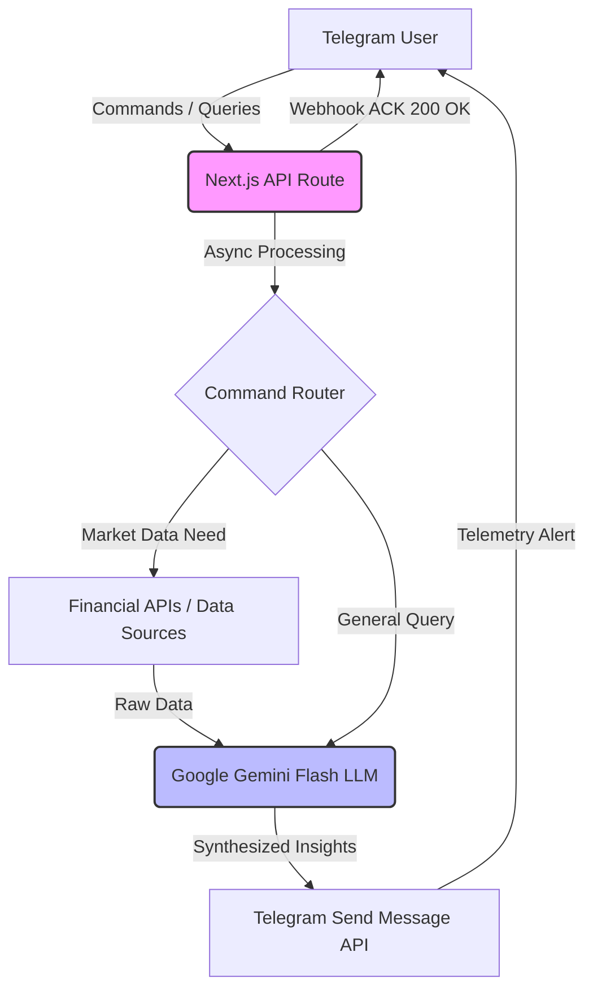

# Telegram Gemini Bot

> **Real-time market data sentiment and financial telemetry bot delivered straight to your phone.**

A Next.js 14 (App Router) Telegram bot using the Gemini API (gemini-flash-latest model) for real-time financial data synthesis and market sentiment delivery. Uses webhooks and the interim-acknowledgment pattern for Vercel serverless.

**Demo video:** _coming shortly_ | **Repository:** you are here | **Author:** [Tejas Hendre](https://www.tejashendre.com/)

---

## 1. The Business Problem (Why I built this)

Professional intelligence workflows depend on speed and accessibility. Checking dashboards requires context-switching; receiving automated, synthesized intelligence directly in a secure messaging client reduces friction. 

This bot was built to act as a financial telemetry engine, consuming real-time market data and using Google's Gemini Flash model to synthesize it into immediately actionable insights delivered on-the-go via Telegram.

---

## 2. System Architecture & Flow

To bypass Vercel's strict serverless timeout limits, the system uses an interim-acknowledgment pattern. It responds to Telegram instantly while processing the actual intelligence payload asynchronously.

---

## 3. Core Principles & Execution (How I do my work)

- **Serverless Resilience:** Designed specifically for Vercel's App Router environment. The webhook immediately returns a 200 OK to Telegram to prevent retry floods, then handles the heavy LLM/API workloads asynchronously.
- **Speed over Bloat:** Uses `gemini-flash-latest` because intelligence delivery on mobile messaging needs to be near-instantaneous.
- **Secure by Default:** Utilizes a custom `CRON_SECRET` to secure scheduled tasks and locks telemetry down to specific authorized `TELEGRAM_CHAT_ID`s.

---

## 4. Tech Stack

- **Framework:** Next.js 14 (App Router), TypeScript
- **APIs:** Telegram Bot API (Webhooks), Google Gemini API
- **Deployment:** Vercel (Serverless Functions)

---

## 5. Usage / Installation

1. Install dependencies: `npm install`
2. Create `.env.local` file with your environment variables.
3. Set Webhook: `curl "https://api.telegram.org/bot<YOUR_BOT_TOKEN>/setWebhook?url=https://YOUR_DOMAIN/api/telegram"`
4. Run locally: `npm run dev`
